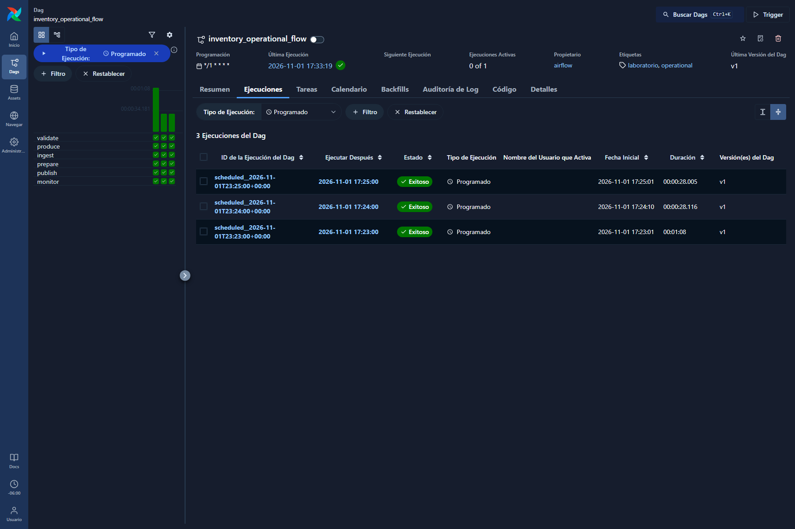
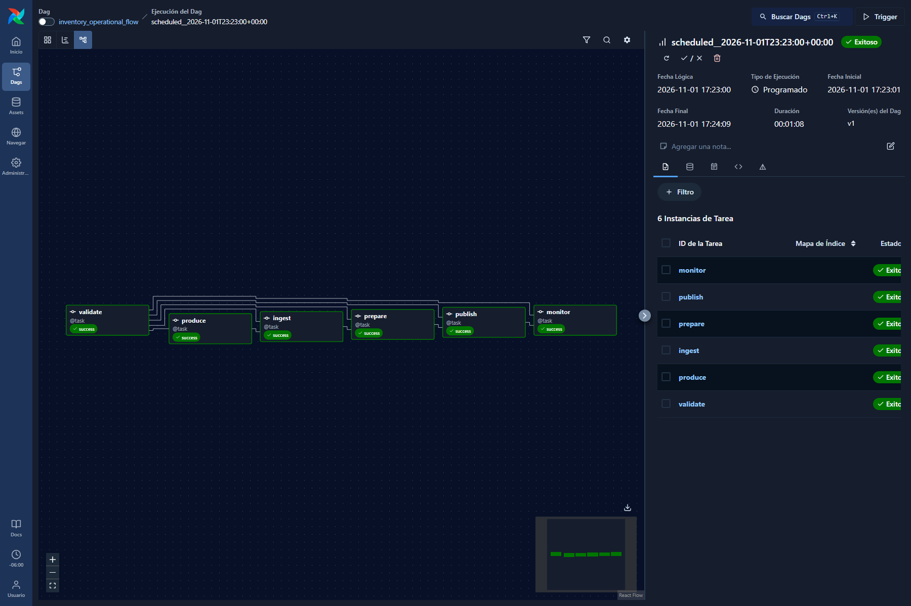

# Evidencias de entrega — Laboratorio 1

## Comparación temporal de modelos

Semana objetivo: **2017-07-25 a 2017-07-31**; publicación `weekly-20170725-20170724T060000Z`, con corte de decisión **2017-07-24 06:00 UTC**. Los valores provienen de `model/model.json` dentro del [período operativo congelado con DVC](../data/reproductions/operational/weekly-20170725-20170724T060000Z__eval-20170726T060000Z.dvc), campos `selection_baseline`, `selection_ml`, `test_baseline` y `test_ml`. Cifras redondeadas a dos decimales; menor es mejor.

| Partición | Modelo | MAE | RMSE | Costo medio de negocio |
| --- | --- | ---: | ---: | ---: |
| Selección | Baseline | 114.98 | 470.56 | **450.74** |
| Selección | Ridge | **107.12** | **395.90** | 459.44 |
| Prueba | Baseline | 96.42 | 341.15 | 290.13 |
| Prueba | Ridge | **76.88** | **268.67** | **287.82** |

Ridge mejora MAE y RMSE en ambas particiones y también el costo en prueba. La regla se fija **antes de prueba**: reemplaza el baseline solo si Ridge reduce el costo en selección más del 5 % sin aumentar MAE. En esta ejecución el costo de Ridge en selección **sube** de 450.74 a 459.44; por eso el modelo publicado es `baseline`. La mejora observada en prueba no cambia la decisión. El costo tabulado mide error de demanda diaria bajo los costos configurados; no es el costo neto de un pedido con inventario. Véanse [la regla y las particiones](../DECISIONES.md#dec-005-selección-con-el-objetivo-de-demanda-calibrado) y [la explicación del modelo](../README.md#pronósticos-semanales-y-evaluación).

## Airflow 3: ejecución programada

La lista filtrada por tipo **Programado** muestra tres runs `scheduled__2026-11-01T23:23:00+00:00`, `scheduled__2026-11-01T23:24:00+00:00` y `scheduled__2026-11-01T23:25:00+00:00`, todos con estado **Exitoso**. Esas horas son ticks reales del scheduler; representan cortes **históricos simulados** del 24, 25 y 26 de julio de 2017 a las 06:00 UTC, respectivamente. No representan ventas de 2026.

El grafo del primer run programado muestra `validate → produce → ingest → prepare → publish → monitor`, con las **seis tareas en success**. Las capturas son de la interfaz Airflow 3 del proyecto Compose aislado `lab1periodiccaptura`; no se editaron ni contienen credenciales. La simulación periódica es optativa y está desactivada por defecto; véase [su procedimiento](../README.md#reloj-periódico-para-una-simulación-histórica).

## Seguimiento del clon limpio

Para la misma publicación, el `refresh` del clon limpio evaluó al **2017-07-26 06:00 UTC** las ventas del primer día objetivo que ya estaban disponibles: **1.782 pares observados** y **10.692 pendientes**. Sobre los observados: **MAE 93.77**, **RMSE 312.30**, **sesgo −59.68** (`venta − q50`) y **cobertura 0.8311** del intervalo 10–90 %. Los pendientes no se trataron como ceros. Los valores están en el reporte `published/monitoring/weekly-20170725-20170724T060000Z/2017-07-26T060000.000000Z.json` del [archivo operativo DVC](../data/reproductions/operational/weekly-20170725-20170724T060000Z__eval-20170726T060000Z.dvc) y en la [evidencia textual de reproducción desde clon limpio](reproduccion_clon_limpio.md).

El [README](../README.md#dvc-de-un-período-operativo-de-airflow) indica cómo recuperar y verificar el período congelado. La [receta desde cinco CSV originales](../README.md#semana-histórica-nueva-desde-los-cinco-csv-originales) permite repetir la ejecución sin usar la instantánea DVC histórica. Las disponibilidades D+1/T0 son simuladas; la prueba del clon limpio no incluyó una corrección de contenido.
